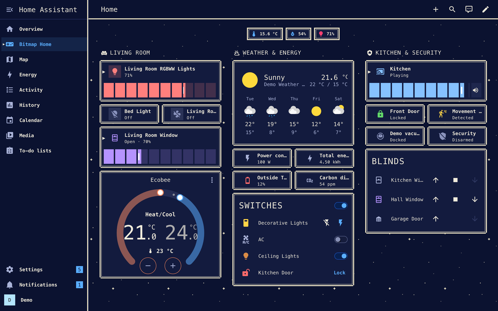
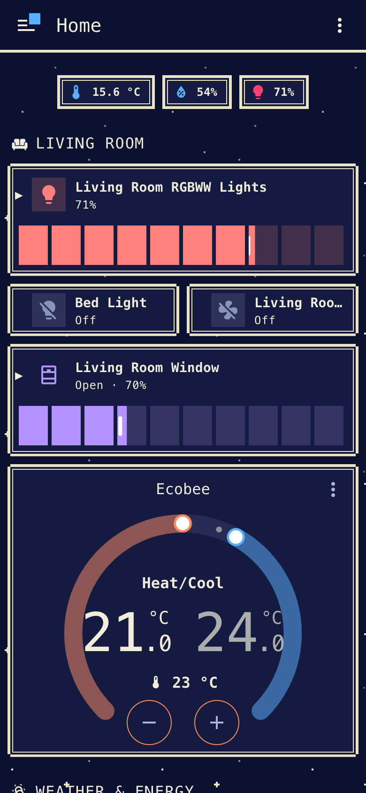
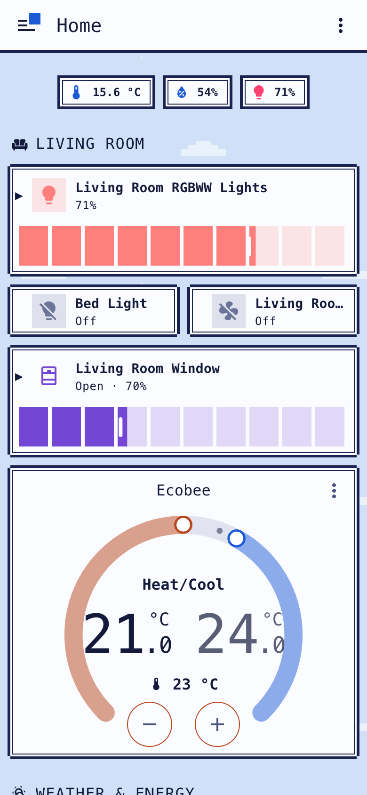
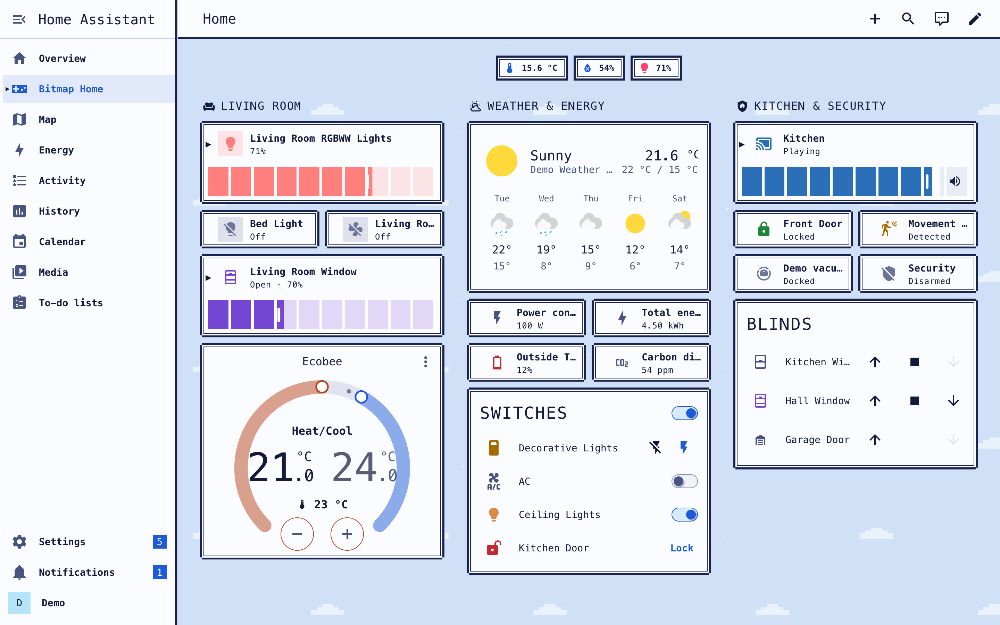
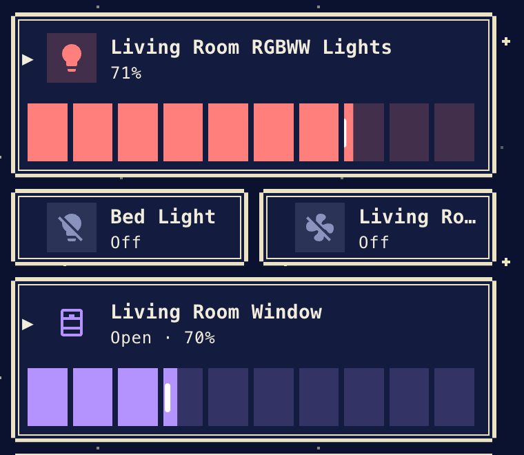
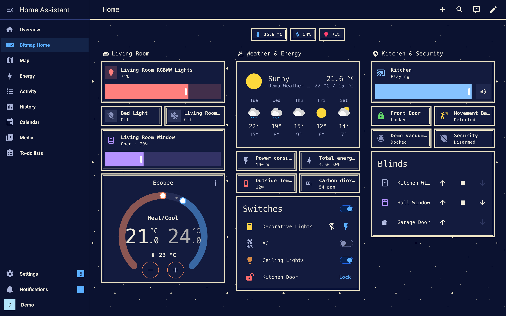
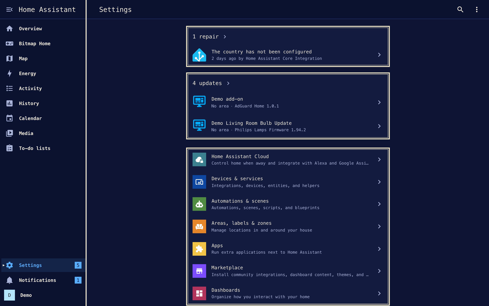
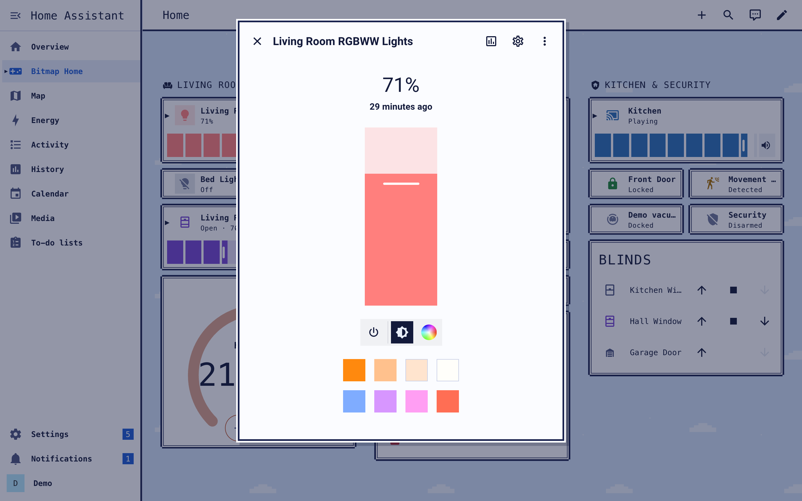

# Bitmap Home

[](https://my.home-assistant.io/redirect/marketplace_repository/?owner=wsclx&repository=bitmap-home-theme&category=theme)

An 8-bit theme for Home Assistant: cards become dialogue windows with a pixel frame, the dashboard sits under a sky of pixel stars, and a ▶ cursor points at what is switched on. Dark and light mode in one theme.



| Dark | Light |
|---|---|
|  |  |



## What you get

- **One theme, two modes.** Night (navy with cream frames and pixel stars) and day (pale sky with navy frames and pixel clouds). It follows the light or dark setting of your profile or device.
- **Dialogue windows.** Cards, badges and dialogs get a double pixel frame. No rounded corners anywhere, hard pixel shadows instead of soft ones.
- **Monospace everywhere.** One system monospace stack for all text (SF Mono, Cascadia Mono, Menlo, Consolas, DejaVu Sans Mono …). Nothing is downloaded. You can add a pixel font yourself, see below.
- **A small console palette.** Lights yellow, safety green, alarms red, media purple, actions in a bright pixel blue. Text meets WCAG contrast (4.5:1) in both modes.
- **Optional extras with card-mod:** a ▶ cursor in front of tiles that are on and in front of the selected sidebar entry, slider bars cut into ten blocks (per tile, see below), notched pixel corners, headings in capitals, a clearer keyboard focus on tiles.



Without card-mod the theme still works: frames, colours, square corners, the starry background and the monospace font come from plain theme variables. Sliders stay solid bars, the sidebar keeps the default font.



Settings and dialogs use the same windows:

| Settings | Dialog |
|---|---|
|  |  |

## Requirements

- Home Assistant with themes enabled. Tested with Home Assistant 2026.11.2 (November 2026).
- Optional: [card-mod](https://github.com/thomasloven/lovelace-card-mod) 4.x for the cursor, the block bars and the other extras. Tested with card-mod 4.2.1.

## Installation

### Marketplace (HACS)

1. Open **Settings → Marketplace** (or HACS on older versions).
2. Search for **Bitmap Home** and download it.
3. Reload themes: **Developer tools → Actions → `frontend.reload_themes`**.

### Manual

1. Copy `themes/bitmap_home.yaml` into the `themes` folder of your configuration.
2. Make sure your `configuration.yaml` loads that folder:

   ```yaml
   frontend:
     themes: !include_dir_merge_named themes
   ```

3. Restart Home Assistant or run `frontend.reload_themes`.

## Use the theme

Open your **profile**, choose **Bitmap Home** under *Theme*, and pick *Auto*, *Light* or *Dark*.

## Optional: card-mod

The theme contains `card-mod-card` and `card-mod-sidebar` rules. They only apply when card-mod is installed. For theme rules, card-mod recommends loading it as a frontend module instead of a dashboard resource:

```yaml
frontend:
  themes: !include_dir_merge_named themes
  extra_module_url:
    - /local/community/lovelace-card-mod/card-mod.js
```

Adjust the path to where card-mod is installed on your system.

- The ▶ cursor appears on tile cards of these domains when they are on or open: `light`, `switch`, `fan`, `media_player`, `climate`, `input_boolean`, `humidifier`, `water_heater`, `vacuum`, `remote`, `siren`, `automation`, `script`, `cover`. Sensors are left out on purpose: the tile card marks every entity with a value as active.
- Tile icons move 10 px to the right to make room for the cursor.

### Block bars

Block bars are switched on per tile, because the same mask would cut button rows (playback controls, colour favourites, fan presets) apart. Give a tile the class `bitmap-blocks` and put the slider as its **first** feature; the first feature row is cut into ten blocks, further rows stay as they are:

```yaml
type: tile
entity: light.living_room
features_position: bottom
features:
  - type: light-brightness
card_mod:
  class: bitmap-blocks
```

This works for any slider feature: brightness, colour temperature, cover position, volume, fan speed as a slider.

## Optional: a pixel font

The theme names the font family **Bitmap Home Pixel** first in its font stack. If a font with that name is available, the whole interface uses it; otherwise the system monospace font is used. The theme itself loads nothing from the internet, so you place the font yourself:

1. Pick a pixel font under a free licence, for example [Pixelify Sans](https://github.com/google/fonts/tree/main/ofl/pixelifysans) (SIL Open Font License, upper and lower case, easy to read) or [Silkscreen](https://github.com/google/fonts/tree/main/ofl/silkscreen) (SIL Open Font License, capitals only, best for short labels).
2. Copy the font file into `www/fonts/` inside your configuration folder, for example `www/fonts/PixelifySans.ttf`. Keep the licence file next to it.
3. Create `www/fonts/bitmap-home-font.css`:

   ```css
   @font-face {
     font-family: "Bitmap Home Pixel";
     src: url("/local/fonts/PixelifySans.ttf") format("truetype");
     font-display: swap;
   }
   ```

4. Add it as a dashboard resource: **Settings → Dashboards → ⋮ → Resources → Add resource**, URL `/local/fonts/bitmap-home-font.css`, type *Stylesheet*. Reload the page.

Dashboard resources load when a dashboard opens, so settings pages show the pixel font only after you have opened a dashboard once. Pixel fonts are harder to read in long lists; if that bothers you, remove the resource and the theme falls back to the system monospace.

## Customise

Change these variables in a copy of the theme, or override them with card-mod.

| Variable | Used for |
|---|---|
| `bitmap-frame` | Colour of the pixel frame around cards, badges and dialogs |
| `bitmap-window` | Fill of the windows (cards) |
| `bitmap-cursor` | Colour of the ▶ cursor (card-mod) |
| `lovelace-background` | Starfield (dark) and clouds (light) behind dashboards, as small inline SVG images |
| `ha-card-box-shadow` | Draws the inner line of the double frame; set it to `none` for a single frame |
| `primary-color`, `ha-color-primary-*` | Action colour and the blue scale the frontend uses for buttons and switches |
| `ha-font-family-body`, `ha-font-family-heading` | Font stacks |

## Known limits

- Icons stay the regular Material Design Icons; the theme cannot replace them with pixel icons. The same goes for the weather icons and the round thermostat dial.
- Toggle switches keep their rounded shape: their radius is fixed inside the frontend and not exposed as a variable.
- Block bars only exist where Home Assistant draws a slider. Battery levels and other sensor values stay numbers.
- Without card-mod, the sidebar uses the default font, because the frontend sets it outside the theme variables.
- Home Assistant does not guarantee theme variables between releases. The card-mod rules target internal elements of the frontend and can break with an update; the theme itself keeps working. If something looks off, please open an issue with your version.

## Contributing

Issues and pull requests are welcome. Please include your Home Assistant version, card-mod version (if used), browser and a screenshot.

## License

[MIT](LICENSE)

The look is inspired by the menus of 8-bit role-playing games in general, not by any particular game. This is a community project. It is not affiliated with or endorsed by Home Assistant or the Open Home Foundation.
